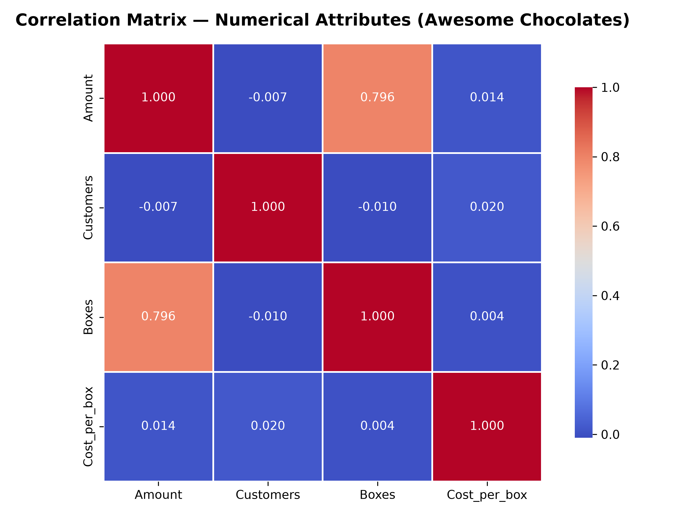

# Week 2: Python & SQL for Data Analysis


Comprehensive completion of **Week 2: Python & SQL for Data Analysis** from the Data Analyst Course. This repository houses complete solutions for the Python Practice Assignment, SQL relational queries, multi-table joins, CASE conditional logic, and database query exports.

---

## 📁 Repository Directory Structure

```
Week-02/
├── data/
│   ├── awesome-chocolates-data.sql    # Raw MySQL database dump (7,617 transactions)
│   ├── awesome_chocolates.db          # Standalone SQLite database for zero-config querying
│   ├── chocolate_sales.csv            # Master enriched dataset (13 attributes)
│   ├── sales.csv                      # Transactional sales table
│   ├── people.csv                     # Sales team and locations table
│   ├── products.csv                   # Chocolate products and categories table
│   ├── geo.csv                        # Geography and regional markets table
│   └── setup_database.py              # Script to build SQLite DB & export normalized CSVs
│
├── python_analysis/
│   ├── Week2_Python_Data_Analysis.ipynb  # Interactive Jupyter Notebook with outputs
│   ├── week2_python_analysis.py          # Standalone executable Python script
│   └── correlation_matrix.png            # High-resolution correlation heatmap visual
│
└── sql_analysis/
    ├── week2_sql_queries.sql             # SQL query suite (Basic, Joins, CASE, 10 Challenges)
    ├── run_sql_analysis.py               # Automated query execution & Excel exporter
    └── Week2_SQL_Query_Results.xlsx      # Multi-sheet Excel workbook of query results
```

---

## 🐍 Part 1: Python for Data Analysis (Practice Questions)

### Question 1: Load a CSV File using Pandas and Display Basic Info
- **Dataset**: `chocolate_sales.csv` (7,617 rows, 13 attributes).
- **Inspection Methods**:
  - `df.shape`: Returns `(7617, 13)`.
  - `df.head(5)`: Displays initial shipments with dates, sales amount, boxes, customer counts, and product metadata.
  - `df.info()`: Confirms column data types (numerical `float64`, integer `int64`, and categorical `object`).
  - `df.describe()`: Generates summary statistics (Average Amount: **$5,718.99**, Average Boxes: **380.90**, Max Order: **$27,146.00**).

---

### Question 2: Handle Missing Values and Duplicates using Pandas
- **Missing Value Audit**:
  - Initial check using `df.isnull().sum()` revealed `Team` contained **1,203 null values** (sales representatives without specific team tags).
  - All financial and operational columns (`Amount`, `Boxes`, `SaleDate`, `Product`, `Country`) had **0 missing values (100% complete)**.
- **Handling Strategy**:
  - Categorical imputation: `df['Team'].fillna('Unassigned', inplace=True)`, ensuring complete categorization without data loss.
- **Duplicate Check**:
  - Checked with `df.duplicated().sum()` -> **0 duplicates**. Applied `df.drop_duplicates()` to maintain idempotence.

---

### Question 3: Group Data by Category and Find Total Revenue
Aggregated using `df.groupby('Category')['Amount'].agg(['sum', 'mean', 'count'])`:

| Product Category | Total Revenue ($) | Average Order Value ($) | Total Boxes Sold | Total Shipments | Revenue Share (%) |
| :--- | :---: | :---: | :---: | :---: | :---: |
| **Bars** | **$21,746,501.00** | $5,698.77 | 1,435,141 | 3,816 | **49.92%** |
| **Bites** | **$13,978,391.00** | $5,807.39 | 848,184 | 2,407 | **32.09%** |
| **Other** | **$7,836,654.00** | $5,621.70 | 617,986 | 1,394 | **17.99%** |
| **Grand Total** | **$43,561,546.00** | **$5,718.99** | **2,901,311** | **7,617** | **100.00%** |

*Insight*: The **Bars** category is the core business driver, generating nearly 50% of overall company revenue.

---

### Question 4: Sort Data by Multiple Columns using Python
1. **Sort by Category (Ascending) & Amount (Descending)**:
   - Identifies highest-value transactions within each category.
   - Top overall transaction: **Van Tuxwell** in New Zealand selling **Almond Choco (Bars)** for **$27,146.00** (1,939 boxes).
2. **Sort by Country (Ascending) & SaleDate (Ascending)**:
   - Organizes chronological order fulfillment pipelines across each geographic market.

---

### Question 5: Create a Correlation Matrix for Numerical Columns
Computed correlation across `Amount`, `Customers`, `Boxes`, and `Cost_per_box`:

| Metric | Amount | Customers | Boxes | Cost_per_box |
| :--- | :---: | :---: | :---: | :---: |
| **Amount** | **1.0000** | -0.0074 | **0.7963** | 0.0136 |
| **Customers** | -0.0074 | **1.0000** | -0.0096 | 0.0200 |
| **Boxes** | **0.7963** | -0.0096 | **1.0000** | 0.0036 |
| **Cost_per_box** | 0.0136 | 0.0200 | 0.0036 | **1.0000** |

*Key Takeaway*:
- **Strong Positive Correlation (0.7963)** between `Amount` and `Boxes`: Order revenue is predominantly driven by shipment volume rather than price variation.
- **Independence of Customers (-0.0074)**: Wholesale shipment size does not depend on the number of individual end customers.



---

## 🗄️ Part 2: SQL for Data Analysis (Assignments & Challenge Problems)

### 1. Core Assignment: Query Sample Database to Find Top Customers & Average Order Values

#### Top 5 Sales Representatives (Customers / Reps) by Total Revenue:
```sql
SELECT 
    p.Salesperson, p.Team, p.Location,
    COUNT(*) AS Total_Orders,
    SUM(s.Boxes) AS Total_Boxes_Sold,
    ROUND(SUM(s.Amount), 2) AS Total_Revenue,
    ROUND(AVG(s.Amount), 2) AS Average_Order_Value
FROM sales s
JOIN people p ON s.SPID = p.SPID
GROUP BY p.Salesperson, p.Team, p.Location
ORDER BY Total_Revenue DESC
LIMIT 5;
```

| Salesperson | Team | Location | Total Orders | Total Boxes | Total Revenue ($) | Average Order Value ($) |
| :--- | :---: | :---: | :---: | :---: | :---: | :---: |
| **Wilone O'Kielt** | Delish | Hyderabad | 308 | 126,830 | **$1,914,157.00** | $6,214.80 |
| **Gunar Cockshoot** | Yummies | Hyderabad | 315 | 124,781 | **$1,899,436.00** | $6,029.96 |
| **Roddy Speechley** | Delish | Seattle | 310 | 122,679 | **$1,892,163.00** | $6,103.75 |
| **Madelene Upcott** | Jucies | Wellington | 312 | 129,665 | **$1,859,305.00** | $5,959.31 |
| **Karlen McCaffrey** | Yummies | Wellington | 308 | 129,331 | **$1,844,955.00** | $5,990.11 |

#### Average Order Value (AOV) by Country:
- **India**: **$5,797.19** *(1,261 shipments, $7,310,254.00)*
- **New Zealand**: **$5,755.35** *(1,292 shipments, $7,435,918.00)*
- **Australia**: **$5,755.27** *(1,262 shipments, $7,263,151.00)*
- **Canada**: **$5,684.53** *(1,293 shipments, $7,350,091.00)*
- **UK**: **$5,674.51** *(1,267 shipments, $7,189,609.00)*
- **USA**: **$5,649.33** *(1,242 shipments, $7,016,478.00)*

---

### 2. Solutions to Official Challenge Problems (Chandoo SQL Tutorial)

| Problem # | Focus / Concept | SQL Solution Summary & Finding |
| :---: | :--- | :--- |
| **P1** | `WHERE Amount > 2000 AND Boxes < 100` | Filtered shipments with high value per box. Identified premium low-volume orders. |
| **P2** | Shipments in January 2022 | Salesperson shipment counts in Jan 2022. Top reps fulfilled up to 15 orders each. |
| **P3** | Milk Bars vs. Eclairs | **Eclairs** sold more total boxes (**144,651 boxes** vs **130,995 boxes** for Milk Bars). |
| **P4** | Milk Bars vs. Eclairs (Feb 1–7, 2022) | **Milk Bars** sold more in the first 7 days of February (**3,595 boxes** vs 2,836 for Eclairs). |
| **P5** | Wednesday Shipments Check | Evaluated low-customer/box orders with `CASE` checking `strftime('%w', SaleDate) = '3'`. |
| **P6** | Active Reps in Jan 1–7, 2022 | Identified 30 salespersons with active orders in early January. |
| **P7** | Inactive Reps in Jan 1–7, 2022 | Identified reps with zero early January shipments using `NOT IN (SELECT ...)`. |
| **P8** | Shipments over 1,000 boxes monthly | Monthly counts of high-volume bulk shipments ranging from 15 to 32 orders/month. |
| **P9** | 'After Nines' to New Zealand | Confirmed uninterrupted monthly shipments of 'After Nines' to NZ across all months. |
| **P10** | India vs. Australia Head-to-Head | Monthly box sales comparison showing India leading in Feb & Mar, Australia in Jan, Apr & May. |

---

## 🛠️ Execution & Reproduction Guide

### Prerequisites
```bash
pip install pandas numpy matplotlib seaborn openpyxl
```

### Run Python Data Analysis Script:
```bash
python python_analysis/week2_python_analysis.py
```

### Run SQL Execution & Excel Exporter:
```bash
python sql_analysis/run_sql_analysis.py
```

---

## 👨‍💻 Course Information
- **Course**: Data Analyst Course — Week 2: Python & SQL for Data Analysis
- **Author**: Durgesh ([@durgesh261](https://github.com/durgesh261))
- **Primary Datasets**: Awesome Chocolates Dataset (`awesome-chocolates-data.sql`, `chocolate_sales.csv`)
